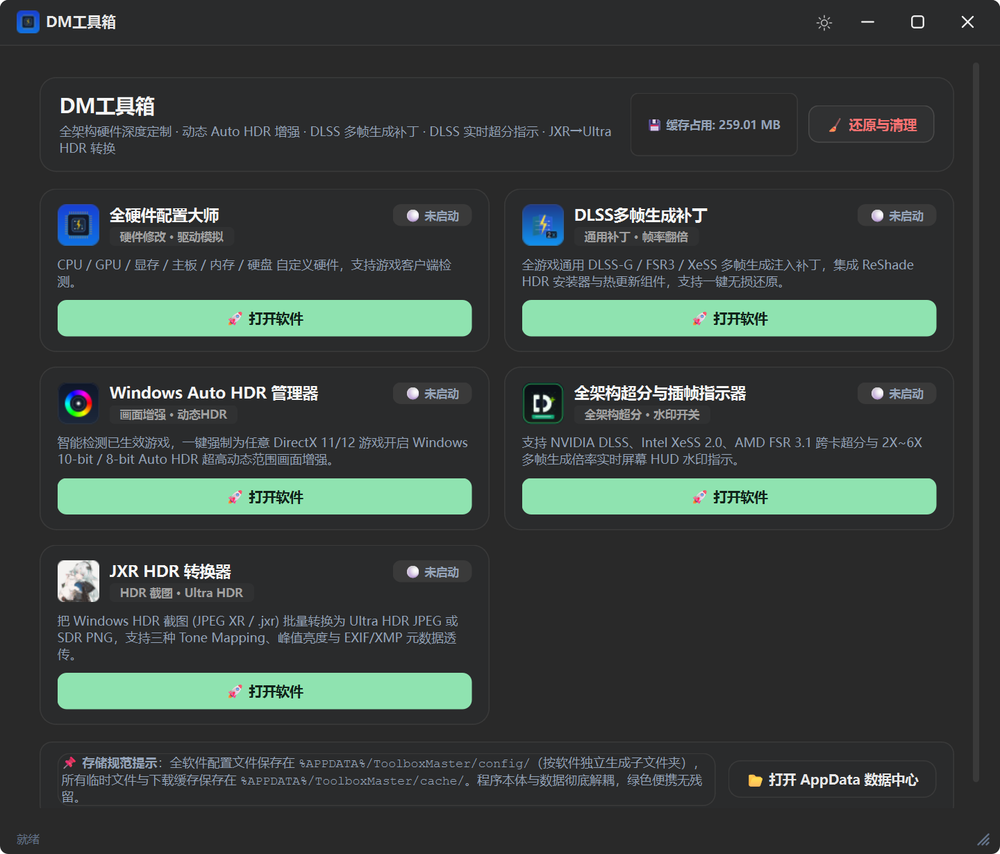
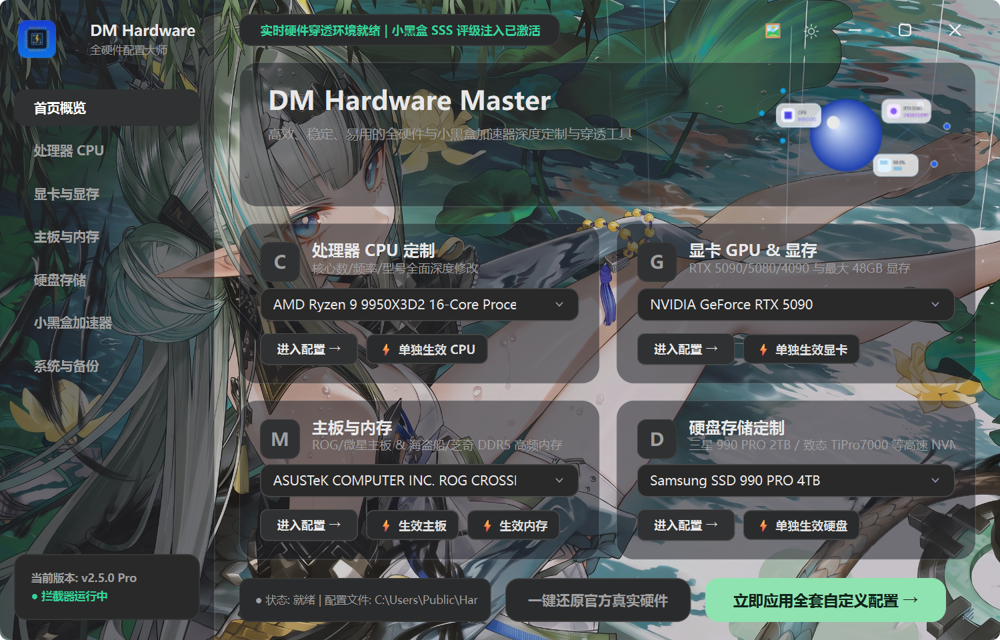
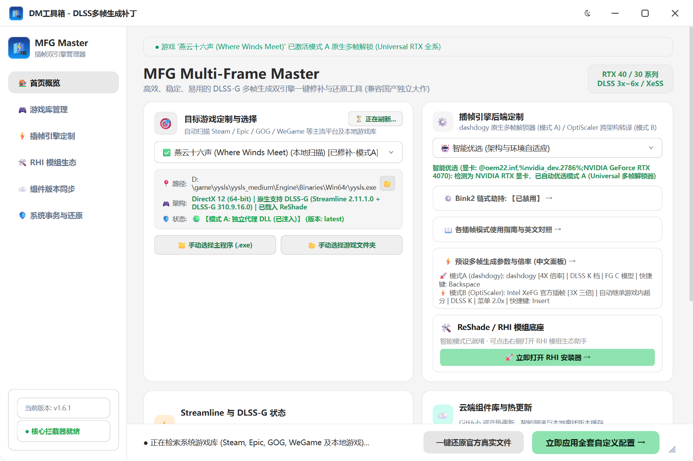
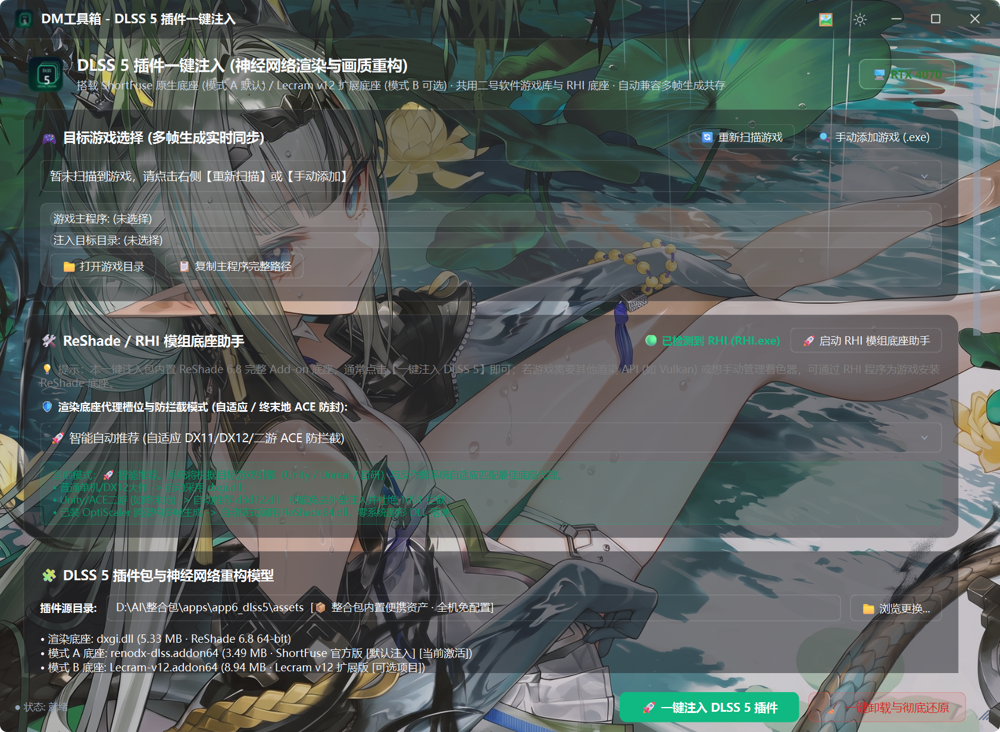

# DM-Toolbox (DM工具箱)

<div align="center">

<picture>
  <source media="(prefers-color-scheme: dark)" srcset="common/assets/preview_main_dark.png">
  <source media="(prefers-color-scheme: light)" srcset="common/assets/preview_main_light.png">
  
</picture>

**一站式全能硬件深度定制、游戏多帧生成补丁、Auto HDR 画质增强、DLSS 5 神经重构与 DLSS 实时监测综合工具箱**

[](https://microsoft.com)
[](https://python.org)
[](https://www.qt.io)
[](https://github.com/Iridescent10-art/DM-Toolbox/releases)

</div>

---

## 🌟 核心功能一览

`DM-Toolbox` 整合了 6 款独立功能模块，采用全新统一的 **DM 通用设计语言底座 SDK (`dm_ui_core.py`)**：
- **DWM 硬件级无锯齿圆角抗锯齿合成 (`DWMWCP_ROUND=2`)**：彻底消除 QSS 软裁剪带来的四角白边与毛边锯齿；
- **全窗口统一右下角双斜线 `//` 矢量缩放手柄 (`DMSizeGrip`)**：主启动器与所有子软件窗口风格 100% 像素级对齐；
- **跨窗口日间 / 夜间模式实时无感同步 (`DMThemeManager`)**。

### 1. 🛠️ 全硬件配置大师 (`app1_hardware`)
- **硬件自定义与检测支持**：CPU / GPU / 显存 / 主板 / 内存 / 硬盘 自定义硬件，支持游戏客户端检测。
- **板块单独设置即时生效**：支持对 **CPU 处理器、独立显卡、主板 BIOS、内存 DDR5、硬盘存储** 每一个硬件板块进行**单独设置与即时生效**（主页快捷卡片与各详情配置页均提供一键单独生效入口），无需全盘重写，灵活高效。
- **全层级驱动模拟覆盖**：穿透覆盖 DirectX Adapter GUID、`Control\Video`、`Enum\PCI` 硬件总线、Windows Class 注册表、BIOS 及 WMI 查询。
- **客户端深度支持**：针对游戏客户端检测提供专属挂钩补丁与即时生效机制，支持一键保存与无损还原官方硬件配置。
- **原生标准对齐与气泡提示**：标准非编辑态单向下拉对齐视图，解决长型号横滚裁切问题，附带悬浮气泡全称提示。

<div align="center">

<picture>
  <source media="(prefers-color-scheme: dark)" srcset="common/assets/preview_hardware_dark.png">
  <source media="(prefers-color-scheme: light)" srcset="common/assets/preview_hardware_light.png">
  
</picture>

</div>

### 2. ⚡ DLSS 多帧生成补丁 (`app2_mfg`)

<div align="center">

<picture>
  <source media="(prefers-color-scheme: dark)" srcset="common/assets/preview_mfg_dark.png">
  <source media="(prefers-color-scheme: light)" srcset="common/assets/preview_mfg_light.png">
  
</picture>

</div>

- **帧率倍增黑科技**：为全架构显卡（RTX 20/30/40/50 系、GTX、AMD Radeon、Intel Arc）解除 DLSS-G / FSR3 / XeSS 插帧限制。
- **全新三核心插帧架构 (20/30 系原生首选 · 40/50 系原生解锁 · 全显卡跨卡转译)**：
  - **🔥 模式 C (dlssg_for_sm86 原生插帧 · RTX 20/30 系首选推荐)**：专为 NVIDIA Turing (RTX 20XX / TITAN RTX) 与 Ampere (RTX 30XX / RTX A系列) 深度研发的原生 DLSS-G 插帧核心！通过底层截获 `NVSDK_NGX_D3D12_EvaluateFeature` 并精准调用官方插帧内核，不挂钩 `IDXGISwapChain::Present`，天生具备与 DLSS 5（ReShade 6.8）零冲突共存基因。
    - **出厂默认黄金参数**：默认配置为 **3X 三倍帧率**（`MaxGeneratedFrames=2`，生成 2 帧，高刷电竞推荐 165Hz~240Hz）、**硬件流水线优化等级 2**（轻量硬件加速，平衡画质与极低延迟）、**DLSS-G 预设模型 Model C**（FG Lite 极速多帧，单帧节省 32%~54% GPU 算力开销）、**插帧内核 DLSS**（强制调用官方 DLSS-G 渲染管线），以及 **超分辨率托管模式 Off**（与 DLSS 5 神经重构完美双轨协同共存）。
    - **极简三件套安全注入**：严格只向游戏根目录注入 `version.dll`（单代理槽位）、`dlssg_sm86.ini` 与专属 `dlssg_sm86\` 内核目录，绝不污染系统环境。当游戏未加载 `version.dll` 时，支持从 `alternatives\` 单项无损热替换为 `winmm.dll`、`dbghelp.dll` 等代理，恪守“换，不是加”原则。
    - **GPU 智能硬件锁**：检测到 RTX 20/30 显卡时，UI 自动锁定默认注入方案为模式 C，未修补游戏自动首选推荐模式 C，杜绝误选与误操作。
  - **模式 A (dashdogy 原生多帧解锁器 · RTX 40/50 系列推荐)**：集成官方最新 Release **`v1.7.0`**，原生支持 NVIDIA RTX 40 / 50 全系列显卡！全面回归官方标准单代理 DLL 注入架构（独立运行默认 `dxgi.dll`，DLSS 5 共存态自动避让迁移至 `version.dll`），彻底移除 Bink2 侵入式劫持，100% 杜绝游戏原版视频播放与动态链接库冲突；内置全自动自愈机制安全恢复任何旧版遗留的 `bink2w64Hooked.dll`，预设面板支持代理槽位自由切换，支持 2X / 3X / 4X / 6X 以及 Dynamic 多倍率插帧，游戏内按 **`Backspace`**（退格键）即刻呼出控制面板实时调校。
    - **原生 DLSS-G 优先与独立 XeMFG 解耦隔离**：默认启用 NVIDIA 原生 DLSS-G 多帧生成，RTX 40/50 系无需解锁开箱即用，20/30 系在模式 A 注入时按需解锁；XeSS 运行库全量收拢至 `RTXMFG-XeSS/` 独立子目录，杜绝污染游戏根目录与模式 B 误识别。
  - **模式 B (OptiScaler 跨架构转译 · 全显卡通用插帧)**：集成官方最新 **`nightly-20261023`** (OptiScaler v10.0.0-pre1) 完整运行库，跨架构将游戏内原生 DLSS 3 桥接至 Intel XeFG 2.0 (2X/3X/4X 官方插帧) 与 AMD FSR 3.1 算力管线。支持全显卡架构（N卡 / A卡 / Intel卡 / GTX 系列），游戏内默认按 **`Insert`** 键呼出专属控制面板。
  - **智能优选 (架构与环境自适应)**：
    - 检测为 NVIDIA RTX 20/30 架构显卡：**100% 自动优选模式 C (dlssg_for_sm86 原生插帧 · 官方首选推荐)**；
    - 检测为 NVIDIA RTX 40/50 架构显卡：**100% 自动优选模式 A (dashdogy 原生多帧解锁器)**；
    - 检测为非 RTX 卡或 AMD/Intel 显卡：**100% 自动优选模式 B (OptiScaler 跨架构转译)**。
  - **🎯 全模式显卡智能自适应模型矩阵 (40/50系默认 Model M · 20/30系默认 Model K)**：
    - 模式 A、模式 B、模式 C 三大核心全面受显卡硬件探针驱动：
      - **RTX 40 / 50 系列显卡**：默认自动匹配 **Model M**（DLSS 4.5 第二代 Transformer 旗舰超分画质模型，解决高动态拖影与模糊）；
      - **RTX 20 / 30 系列显卡**：默认自动匹配 **Model K**（DLSS 4 经典高锐度与高能效模型，兼顾画质细腻度与流畅度）；
    - 支持完整 AI 模型预设自由热切换：包含 Preset M / L / K / J 及 CNN 终极版（Preset E/C/F），支持 INI 正反向实时同步。
  - **与 DLSS 5 (RenoDX) 双注入深度协同与自动回退保护**：
    - `dxgi.dll` 严格独占归属 DLSS 5 (ReShade 6.8)，模式 C / 模式 A / 模式 B 动态自适应迁移至 `version.dll` / `winmm.dll`，完全避免动态库覆盖与 Agility SDK Loader Lock 闪退；
    - **模式 B 智能自动回退与恢复**：若先注入模式 B 后注入 DLSS 5，系统自动将模式 B 安全回退避免底层 XESS 与 DLSS 5 冲突；当卸载 DLSS 5 时，模式 B 会自动检测并无缝恢复；
    - 协同调度：当检测到 DLSS 5 注入时，模式 C 自动设置 `[SuperResolution] Mode=Off`，超分画质全权交由 DLSS 5 神经网络处理，插帧由 dlssg_sm86 原生处理，实现【神经重构 + 原生 DLSS-G 插帧】双通道并行运作，零抢占零冲突！
- **ReShade 框架防冲突与 `dxgi.dll` 避让锁**：
  - 存在 ReShade 底座时，`dxgi.dll` 绝对锁死留给 ReShade，OptiScaler 自动退避使用 `version.dll` 或 `winmm.dll`，实现两大框架无冲突丝滑共存。
- **游戏内外参数【双向实时同步】**：
  - **正向同步**：统一通过 `IniConfigManager` 保持注释与结构，UI 调整参数后即刻写入游戏根目录 `RTXMFG-UI.ini`、`mfg_unlocker.ini`、`OptiScaler.ini`（v0.9.4 唯一合法配置，自动清除遗留 `nvngx.ini`）与 `ReShade.ini` (`[RenoDX.MFGUnlock]`)；
  - **反向同步**：内置 `QFileSystemWatcher` 后台防抖监听（400ms Debounce + 抑制自循环），游戏内按快捷键调参保存后，桌面软件 UI 自动反向同步刷新！
- **集成 ReShade HDR (RHI) 与云端智能测速同步**：
  - 内置独立离线 RHI-Setup.exe，直连 RankFTW/RHI 官方 GitHub 仓库热更新；
  - 拥有与主工具箱完全一致的 **智能测速优选**（GH-Proxy / GHFast / 直连等多节点并发 Ping 测速与徽章标注），自动锁定最低延迟节点，支持多节点无缝故障转移；
  - 一键异步检查并同步 Mode A / Mode B 双插帧核心与 RHI 工具包，安全隔离存放于系统 AppData，不污染游戏或软件目录。

> [!WARNING]
> **反作弊与多人联机安全须知 (Anti-Cheat Warning)**：
> 多帧生成与跨架构转译补丁通过向游戏根目录植入代理动态库（如 `dxgi.dll`、`version.dll`、`winmm.dll` 等）来拦截图形 API 并调度插帧管线。**严禁在任何配备在线反作弊系统（如 EAC、BattlEye、Vanguard、Ricochet、ACE、VAC 等）的多人联机或竞技网游中使用！** 反作弊程序极易将 DLL 注入与函数拦截识别为未授权第三方外挂，可能导致账号被封禁。本项目仅供单机离线游戏与图形技术研究交流，**若在反作弊环境中使用造成封号，所有后果由使用者自行承担！**

### 3. 🌈 Windows Auto HDR 管理器 (`app3_autohdr`)
- **强制全局高动态范围**：解决部分 DirectX 11/12 游戏因未获微软认证而无法开启 Auto HDR 的问题。
- **自动游戏检测与配置**：智能识别系统中已安装的兼容游戏，一键配置 10-bit / 8-bit 高精度颜色映射。

### 4. 🔍 全架构超分与插帧水印指示器 (`app4_dlss`) (v1.2.0 重构升级)
- **4 大独立分项与一键总控**：
  1. `🟢 NVIDIA DLSS 官方超分水印`：注册表底层 `ShowDlssIndicator=1024`，左下角显示 DLSS 版本、渲染分辨率与 Preset 档位；
  2. `🔵 OptiScaler 性能叠加`：写入游戏 `OptiScaler.ini` 的 `[Menu] ShowFps`，在屏幕左上角显示当前超分引擎、渲染→输出分辨率与实时帧率；
  3. `⚡ 帧生成 Full 叠加`：将 OptiScaler 叠加升级为 `FpsOverlayType=4`，显示实时/插帧后双 FPS、FG 管线与 Reflex 延迟，用双 FPS 比值即可判断 2X / 3X / 4X；
  4. `📊 ReShade 帧率监控`：写入游戏 `ReShade.ini` 的 `[OVERLAY] ShowFPS / ShowFrameTime`（需已安装 ReShade 底座）。
- **全架构超分与插帧刷新率速查指南**：包含 2X (120Hz~144Hz)、3X (165Hz~180Hz)、4X~6X (240Hz~360Hz) 刷新率匹配防撕裂最佳实践。

### 5. 🖼️ JXR HDR 转换器 (`app5_jxr`)
- 把 Windows HDR 截图（JPEG XR / `.jxr`）批量转换为 **Ultra HDR JPEG** 或 **SDR PNG**，支持拖拽文件/文件夹与后台并发队列。
- 内置 Google `libultrahdr 1.5.1` + `libjpeg-turbo 3.2.0`，支持 `libultrahdr` / `ACES` / `BT.2446` 三种 Tone Mapping、JPEG 质量 60–100、峰值亮度自动/预设/自定义、EXIF/XMP 元数据透传。
- 独立单文件 `JxrConverter.exe`（约 66MB，免 .NET 运行时安装），由启动器以外部 EXE 方式打开；**沿用作者原始图标，未做任何修改**。
- **深 / 浅主题切换**：标题栏太阳/月亮按钮即时切换，选择保存到 `settings.json`；强调色由蓝色改为浅绿色，界面与工具箱的 DM 中性主题一致。

### 6. 🧠 DLSS 5 神经重构注入器 (`app6_dlss5`)

<div align="center">

<picture>
  <source media="(prefers-color-scheme: dark)" srcset="common/assets/preview_dlss5_dark.png">
  <source media="(prefers-color-scheme: light)" srcset="common/assets/preview_dlss5_light.png">
  
</picture>

</div>

- **RenoDX DLSS 5 最新优化底座**：一键部署 ReShade 6.8 Add-on 底座 (`dxgi.dll`) + 最新官方底座 `renodx-dlss.addon64` + `nvngx_dlssnr.dll`，为 DLSS 超分接管神经网络渲染与画质重构，带来极高稳定性与抗伪影表现。
- **架构自适应运行库**：按物理显卡自动选择模型——RTX 20/30/40 用 263.37 MB 版本、RTX 50 (Blackwell) 用 254.08 MB 版本，避免内核与硬件不匹配。
- **极致显存与性能调优**：默认出厂预设采用最小显存缓冲占用（Minimal 显存模式），根治显存占用虚高；出厂默认挂钩点深度优化为“之后 (Upscaled)”，彻底解决 4K 分辨率下的 GPU 挂起与死锁。
- **细腻真实的人像质感**：默认皮肤结构强度与神经重构参数深度优化（默认值设定为 100%），呈现细腻通透的真实人像质感。
- **离线挂钩模式控制台 (免启动游戏)**：软件内新增独立挂钩阶段调节控制台，提供“之后 (Upscaled · 推荐防闪退)”与“呈现 (Present)”模式快速切换；支持已注入游戏免启动一键修改并实时同步配置文件，彻底解决因配置冲突导致游戏启动闪退而无法进入游戏菜单调整的死锁痛点。
- **游戏原生依赖智能自愈引擎**：注入前与还原后自动校验并补齐游戏原生静态导入的 PE 依赖库（`libxess.dll`, `libxess_fg.dll`, `libxell.dll` 等），彻底杜绝赛博朋克 2077、巫师 3 启动时提示缺失 DLL 的系统级报错。
- **与多帧生成全自动协同共存**：模式 A / 模式 B 同时注入时自动做 DLL 槽位隔离（ReShade 独占 `dxgi.dll`、模式 A/B 智能迁移至 `winmm`/`version`），并清理 fakenvapi 与重复 ReShade 实例，彻底解决双注入闪退问题。
- **游戏内中文面板**：按 `Home` 呼出 RenoDX 中文调参面板（Preset / 风格 / 强度 / 皮肤结构 / 显存缓冲），`F6` 实时开关神经重构。
- **无损还原**：一键卸载并深度净化 ReShade / DLSS 5 / runtime / 代理 DLL，100% 恢复游戏原生目录。

---

## 💾 存储规范与绿色便携架构

程序遵循现代 Windows 绿色应用设计标准，**程序本体文件与用户持久化数据彻底解耦**：
- **配置文件持久化**：统一存储于 `%APPDATA%/ToolboxMaster/config/{app_name}/`
- **临时缓存与下载**：统一存储于 `%APPDATA%/ToolboxMaster/cache/{app_name}/`
- **一键出厂重置**：主页内置“🧹 还原与清理”功能，可一键关闭运行进程、清空缓存并毫秒级还原至 `defaults/` 出厂初始配置。

---

## 📦 安装与下载

### 方式一：下载 Windows 独立安装包 (推荐)
直接在 [Releases 页面](https://github.com/Iridescent10-art/DM-Toolbox/releases) 下载最新版的 `DM-BOX.exe`：
- **零环境依赖**：内置专属优化版绿色 Python 3.14 运行时环境，无需安装 Python。
- **标准安装体验**：默认安装至 `C:\Program Files\DMBOX`，提供桌面快捷方式创建选项。
- **原生极速启动**：安装后由原生编译的 `DMBOX.exe` 直接拉起，自带管理员授权。

### 方式二：从源码运行与二次开发
1. 克隆本仓库：
   ```bash
   git clone https://github.com/Iridescent10-art/DM-Toolbox.git
   cd DM-Toolbox
   ```
2. 安装依赖库：
   ```bash
   pip install PySide6 pillow
   ```
3. 启动工具箱：
   - 双击根目录下的 `一键启动DM工具箱.bat`，或在终端执行：
     ```bash
     python launcher/main.py
     ```

---

## 🔨 本地构建安装包

如果您修改了代码并希望重新制作单文件安装包：
直接双击根目录下的 **`一键打包制作安装包.bat`**，即可自动调用 Inno Setup 编译器在 `dist_setup/` 下生成最新的高压缩安装程序。

---

## 🙏 致谢开源项目 (Acknowledgments & Open Source Credits)

DM-Toolbox 的诞生与演进离不开全球开源社区与图形学极客们的无私奉献。在此特别向本项目所引用、集成或借鉴的上游优秀开源项目及核心作者表达崇高的敬意与诚挚的感谢：

- **[dlssg_for_sm86](https://github.com/sdli1995/dlssg_for_sm86)** (by sdli1995) - 极其优秀的专为 Turing / Ampere (RTX 20/30 系列) 显卡打造的原生 DLSS-G 插帧移植核心，通过高能效 SM75/SM86 本地加速内核与 FG Lite 架构，为老卡赋予官方级原生插帧新生。
- **[OptiScaler](https://github.com/cdozdil/OptiScaler)** (by cdozdil) - 卓越的跨显卡架构超分辨率与帧生成转译框架，为全卡畅玩提供底层驱动级可能。
- **[MFG-Unlocker](https://github.com/dashdogy)** (by dashdogy) - 极具创新的 DLSS 多帧生成解除与链式代理核心。
- **[RenoDX](https://github.com/clshortfuse/renodx)** (by clshortfuse / mavismmg) - 深度光流调度与高级帧生成优化插件。
- **[ReShade](https://reshade.me/)** (by Crosire & ReShade Community) - 行业标准的通用后期处理着色器底层底座。
- **[Intel® XeSS / XeFG](https://github.com/intel/xess)** - 高品质 AI 超分与帧生成 SDK。
- **[AMD FidelityFX™ SDK](https://github.com/GPUOpen-LibrariesAndSDKs/FidelityFX-SDK)** - 开放的 FSR 空间放大与帧生成套件。
- **[Qt / PySide6](https://www.qt.io)** - 现代高品质 Fluent GUI 设计系统底座。

---

## 🚫 严禁倒卖与开源声明 (Anti-Resale & License Notice)

> [!CAUTION]
> **本项目完全免费、纯开源发布，严禁任何形式的倒卖、付费售卖、捆绑收费或商业谋利！**

1. **完全免费**：DM-Toolbox 是一款公益开源工具箱，官方发布的源码、安装包及所有功能模块**永久免费**提供给广大玩家个人学习、技术研究与测试使用。
2. **严禁倒卖**：严禁任何个人或组织将本项目（包括源码、编译成品、衍生打包或内置组件）在各电商平台（淘宝、闲鱼、拼多多等）、社交平台、自媒体平台进行**任何形式的明码标价售卖、付费入群、赞助获取、捆绑收费**！
3. **谨防受骗**：凡是以“独家内部版”、“防封付费定制”、“独家加速器”、“永久激活版”等名目向您收取任何费用的，**均为未经授权的侵权倒卖行为，请广大玩家切勿受骗并积极举报！**
4. **技术学习声明**：本工具箱仅供个人计算机图形优化、画质增强、多屏校准与硬件测试学习交流之用。请在法律法规与游戏最终用户许可协议允许的范围内合理使用。
5. **反作弊与封禁免责声明**：本工具箱所集成的多帧生成、DLL 代理及渲染注入技术仅面向单人单机游戏与图形测试。任何在线联机或配备反作弊保护的游戏均可能因 DLL 拦截触发安全封禁，使用者须自行辨别并承担全部风险与责任，本项目及开发者不对任何账号封停、数据损失或连带责任负责。
