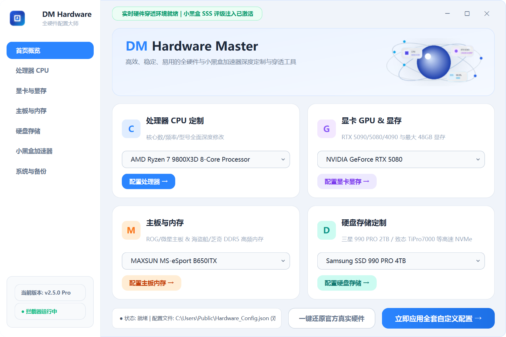

<div align="center">

# ⚡ DM Hardware Master (全套硬件配置自定义大师)

**深度定制与伪装 Windows 系统全套核心硬件信息的现代化桌面工具**

[](https://github.com/Iridescent10-art)
[](https://python.org)
[](https://riverbankcomputing.com/software/pyqt/)
[](LICENSE)

<br/>



</div>

---

## 💡 简介 (Overview)

**DM Hardware Master** 是一款采用 Fluent Design 现代化毛玻璃设计风格的全套硬件配置管理工具。支持对 **CPU 处理器、独立显卡/显存、主板 BIOS、内存 (RAM) 以及固态硬盘 (SSD)** 的深度自定义与伪装。

具备注册表底层劫持、DirectX/DXGI 驱动描述重构、ACPI 核心枚举与 Electron / N-API 内存 Hook 等多层拦截技术，可无缝突破任务管理器、DirectX/DXGI 适配器、设备管理器及小黑盒加速器等硬件检测。

---

## ✨ 核心特性 (Features)

- 🎨 **双主题无缝切换 (Light & Dark Theme)**：内置精心调校的 **☀️ 白天模式 (Light Card)** 与 **🌙 黑夜模式 (Deep Slate)**，支持右上角标题栏一键平滑热切换，自动记忆偏好。
- 🖥️ **全套核心硬件深度定制**：
  - **处理器 (CPU)**：重写 `CentralProcessor` 所有逻辑核心注册表、ACPI 描述与核心数呈现，内置 9850X3D、9950X3D、9950X3D2 等全套顶级芯片及自定义输入。
  - **显卡 (GPU) & 显存 (VRAM)**：DirectX/DXGI 适配器重映射、`Control\Video` 全链路多通道及 `DedicatedVideoMemory` 显存重定义。
  - **主板 (Motherboard)**：系统 BIOS `BaseBoardManufacturer`、`BaseBoardProduct`、`SystemManufacturer` 与型号定制，兼容微星/华硕/七彩虹等品牌前缀。
  - **内存 (RAM)**：品牌、容量（16GB ~ 128GB）及频率（3600MHz ~ 8400MHz）全面自定义。
  - **硬盘 (SSD/NVMe)**：覆盖底层总线 `Enum\SCSI` 驱动设备与设备管理器 FriendlyName。
- ⚡ **小黑盒专属 N-API Hook 实时拦截与跨盘符自适应**：
  - 支持多级全盘与跨盘符自动探测安装根目录、注册表与正在运行进程嗅探，同时支持手动浏览指定与状态实时自检。
  - 自动解包与注入 Electron `app.asar`，内存实时篡改 `getHardwareInfo()` 返回对象，强制激活云端 SSS 顶级神级评分与 99.9% 玩家超越率。
- 🔄 **0 风险一键完全还原**：内置官方出厂真实硬件信息备份与一秒还原机制，随心切换无残留。

---

## 📂 项目结构 (Structure)

```text
├── assets/                  # 软件图标、横幅及 UI 视觉资源
│   ├── app_icon.ico         # 高清多尺寸应用图标
│   ├── app_icon.png         # 应用矢量透明 PNG
│   ├── hero_graphic.png     # 顶部视觉横幅
│   └── preview.png          # 软件运行预览截图
├── main_window.py           # 现代化 Fluent PyQt6 主界面源码
├── cpugpu_gui.py            # 底层配置控制台逻辑
├── apply_config.ps1         # 底层硬件深度注入 PowerShell 脚本
├── restore_config.ps1       # 官方出厂硬件还原 PowerShell 脚本
├── patch_webapp.py          # 小黑盒 ASAR 解包注入挂钩脚本
├── xiaoheihe_index.js       # 小黑盒 N-API 硬件拦截注入代码
├── config.json              # 默认硬件参数配置文件
├── 打开图形配置面板.bat      # 快速启动批处理脚本
├── 一键应用自定义配置.bat    # 静默一键应用批处理
└── 一键还原官方真实配置.bat  # 静默一键还原批处理
```

---

## 🚀 快速开始 (Quick Start)

### 方式一：运行打包版独立可执行文件（推荐）
1. 前往 [Releases](https://github.com/Iridescent10-art) 页面下载最新发布的 `CPU_GPU配置管理工具.exe`；
2. 鼠标右键以**管理员身份运行**即可启动图形面板；
3. 选择所需的硬件预设或手动输入，点击 **【一键深度应用全套硬件修改】**。

### 方式二：通过 Python 源码运行
```bash
# 1. 克隆本仓库
git clone https://github.com/Iridescent10-art/PC-Hardware-Customizer.git
cd PC-Hardware-Customizer

# 2. 安装依赖
pip install PyQt6

# 3. 运行程序（需管理员权限命令行）
python main_window.py
```

---

## 🛠️ 打包编译 (Build from Source)

本项目可通过 PyInstaller 一键编译为无外部依赖的独立免安装单文件 EXE：

```powershell
pyinstaller --noconfirm --onedir --windowed `
  --icon "assets/app_icon.ico" `
  --name "CPU_GPU配置管理工具" `
  --uac-admin `
  --add-data "assets;assets" `
  --add-data "apply_config.ps1;." `
  --add-data "restore_config.ps1;." `
  --add-data "config.json;." `
  --add-data "patch_webapp.py;." `
  --add-data "xiaoheihe_index.js;." `
  main_window.py
```

---

## ⚠️ 免责声明 (Disclaimer)

本项目仅供计算机技术研究、系统展示与前端界面测试交流使用，请勿用于非法欺诈、虚假销售等违法违规场景。使用本工具所产生的一切后果由使用者自行承担。

---

## 📄 开源许可证 (License)

本项目采用 [MIT License](LICENSE) 开源许可证。
